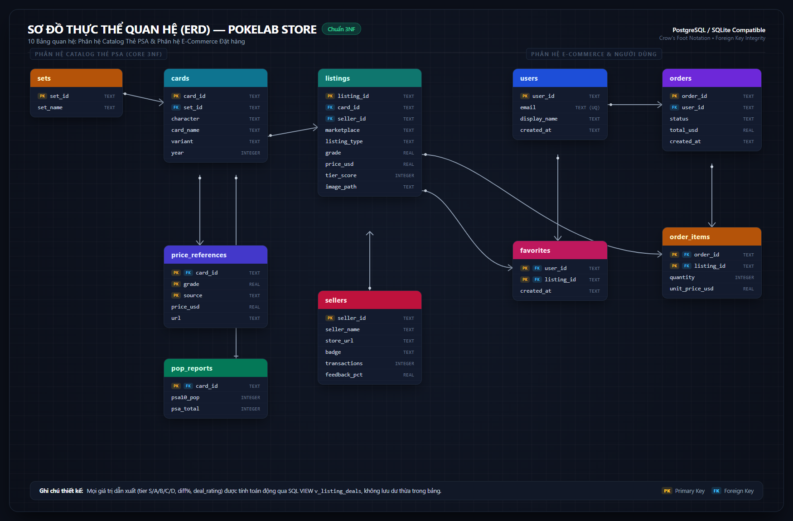
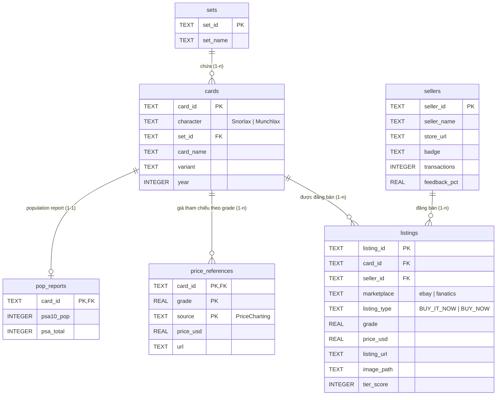
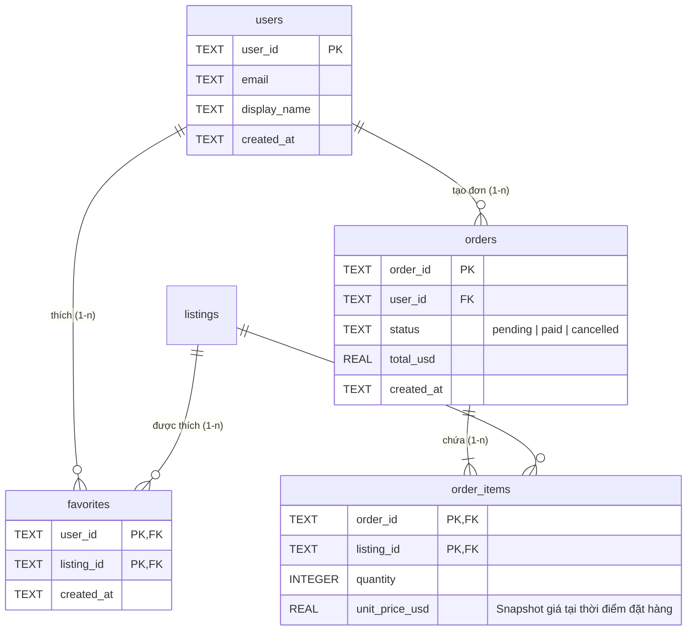

# ERD — Catalog thẻ PSA (sau chuẩn hóa)

## Từ 1 bảng phẳng thành 6 bảng quan hệ (3NF)

Mỗi object trong `data/catalog/catalog.json` ban đầu trộn lẫn nhiều thực thể. Ví dụ: thông tin seller "Official PSA Store" bị lặp lại ở **338 dòng**. Khi seller cập nhật điểm feedback hay số lượng giao dịch, ta sẽ phải sửa đồng loạt 338 chỗ (**update anomaly**). Nếu xóa hết tin đăng của seller đó thì thông tin seller cũng biến mất (**deletion anomaly**).

| Nhóm field trong JSON | Phụ thuộc vào | Bảng quan hệ | Ghi chú chuẩn hóa |
|---|---|---|---|
| `set` | Tên set phát hành | `sets` | 1 set có nhiều thẻ |
| `character`, `name`, `variant`, `year` | Bản in thẻ | `cards` | `year` phụ thuộc vào từng thẻ (cùng set Jungle có cả bản 1996 và 1999) |
| `seller`, `sellerHref`, `sellerBadge`, `sellerTransactions`, `sellerFeedback` | Người bán | `sellers` | Tránh lặp lại thông tin seller hàng trăm lần |
| `id`, `grade`, `listingPriceUSD`, `listingUrl`, `image`, `tierScore`... | Tin đăng bán | `listings` | Mỗi tin đăng là một slab cụ thể có grade và giá riêng |
| `pricecharting`, `priceChartingUrl` | Cặp (thẻ, grade) | `price_references` | Cùng một thẻ nhưng PSA 10 và PSA 9 có giá tham chiếu khác nhau |
| `psa10pop`, `psaTotal` | Thẻ | `pop_reports` | Báo cáo dân số PSA của mẫu thẻ (1-1 với cards) |
| `tier`, `diffPercent`, `dealRating` | Tính từ `tierScore` & giá | *(Không lưu)* | Trường suy dẫn -> dùng VIEW `v_listing_deals` |

---

## Sơ đồ ERD trực quan (Full 10 bảng quan hệ)

---

## Sơ đồ ERD cốt lõi (Catalog PSA)

---

## Mở rộng cho hệ thống E-Commerce (Bán thẻ trực tuyến)

Khi xây dựng đầy đủ chức năng giỏ hàng, đặt hàng, danh sách yêu thích và quản lý người dùng:

### Điểm nhấn thiết kế quan hệ & dữ liệu:
1. **Bảng trung gian `favorites` (n-n giữa `users` và `listings`)**: Khóa chính kết hợp `(user_id, listing_id)` ngăn trùng lặp yêu thích.
2. **Quan hệ `orders` và `order_items` (1-n)**: Mỗi đơn hàng có nhiều món hàng.
3. **Phi chuẩn hóa có chủ đích (`order_items.unit_price_usd`)**: Lưu lại chính xác giá của listing tại thời điểm khách bấm đặt hàng. Nếu sau này listing đổi giá hoặc bị xóa, thông tin tài chính và hóa đơn lịch sử vẫn bất biến.
