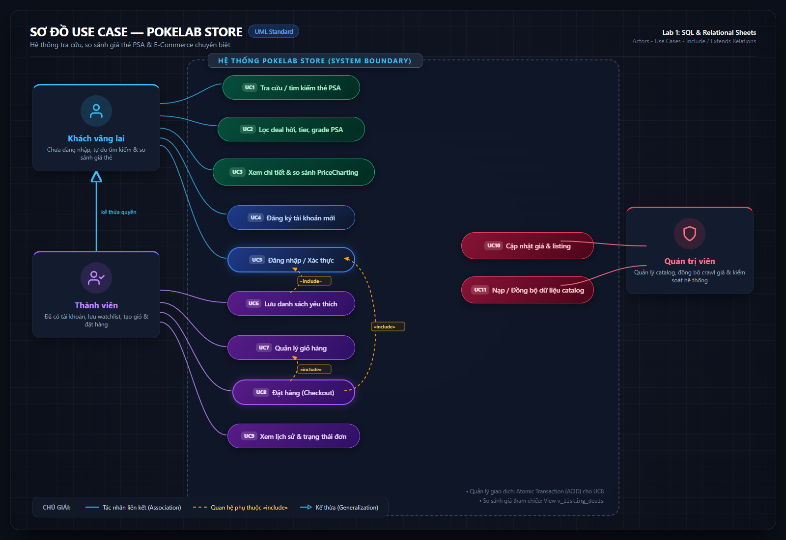
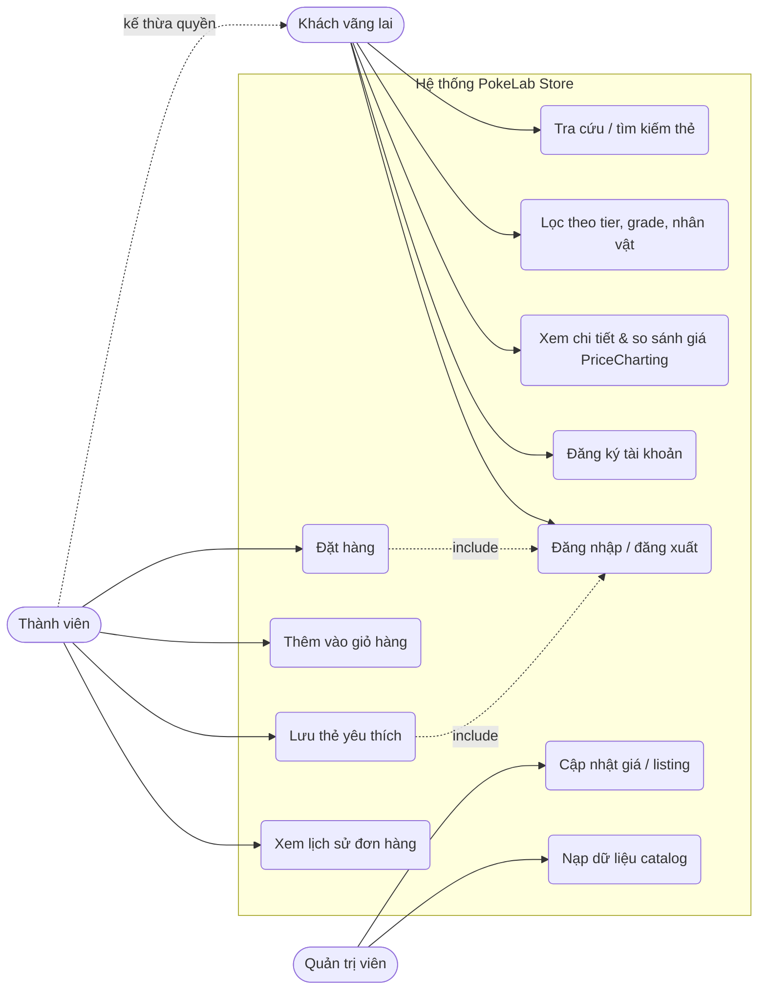

# Sơ đồ Use Case — Website tra cứu & bán thẻ PSA

## 1. Sơ đồ Use Case trực quan



### Sơ đồ mã nguồn (Mermaid)



---

## 2. Ma trận CRUD (Actor - Use Case - Bảng đọc/ghi)

| Use Case | Actor | Bảng đọc (Read) | Bảng ghi (Write) | Ghi chú kỹ thuật |
|---|---|---|---|---|
| **UC1**: Tra cứu / tìm kiếm | Khách, Thành viên | `listings`, `cards`, `sets` | — | Tìm theo tên thẻ, tên set, từ khóa |
| **UC2**: Lọc theo tier, grade, nhân vật | Khách, Thành viên | `v_listing_deals` (VIEW) | — | Lọc nhanh các deal "SIÊU HỜI", grade 9, 10 |
| **UC3**: Xem chi tiết & so sánh giá | Khách, Thành viên | `listings`, `price_references`, `pop_reports`, `sellers` | — | So sánh `price_usd` với `PriceCharting` & độ hiếm PSA |
| **UC4**: Đăng ký tài khoản | Khách | — | `users` | Thêm user mới (`user_id`, `email`,...) |
| **UC5**: Đăng nhập / đăng xuất | Khách, Thành viên | `users` | — | Xác thực phiên làm việc |
| **UC6**: Lưu thẻ yêu thích | Thành viên | `favorites` | `favorites` | `INSERT` hoặc `DELETE` record theo `(user_id, listing_id)` |
| **UC7**: Quản lý giỏ hàng | Thành viên | `listings` | (Session / Client State) | Giữ danh sách listing dự định mua |
| **UC8**: Đặt hàng (Checkout) | Thành viên | `listings` | `orders`, `order_items` | Bắt buộc chạy trong **Transaction** để đảm bảo tính toàn vẹn |
| **UC9**: Xem lịch sử đơn hàng | Thành viên | `orders`, `order_items`, `listings` | — | Xem trạng thái đơn: pending / paid / cancelled |
| **UC10**: Cập nhật giá / listing | Quản trị viên | `listings` | `listings` | Điều chỉnh giá, ẩn/hiện tin đăng |
| **UC11**: Nạp dữ liệu catalog | Quản trị viên | — | `sets`, `cards`, `sellers`, `listings`, `price_references`, `pop_reports` | Chạy script import hàng loạt (batch import) |

---

## 3. Phân tích mẫu câu truy vấn SQL nghiệp vụ

- **UC2 (Lọc deal hời)**:
  ```sql
  SELECT * FROM v_listing_deals 
  WHERE deal_rating = 'SIÊU HỜI' AND grade = 10 
  ORDER BY diff_pct ASC;
  ```

- **UC6 (Lưu yêu thích)**:
  ```sql
  INSERT OR IGNORE INTO favorites (user_id, listing_id, created_at)
  VALUES ('usr_123', 'fc-snorlax-001', datetime('now'));
  ```

- **UC8 (Đặt hàng với Transaction)**:
  ```sql
  BEGIN TRANSACTION;
  INSERT INTO orders (order_id, user_id, status, total_usd, created_at)
  VALUES ('ord_999', 'usr_123', 'pending', 150.00, datetime('now'));

  INSERT INTO order_items (order_id, listing_id, quantity, unit_price_usd)
  VALUES ('ord_999', 'fc-snorlax-001', 1, 150.00);
  COMMIT;
  ```
